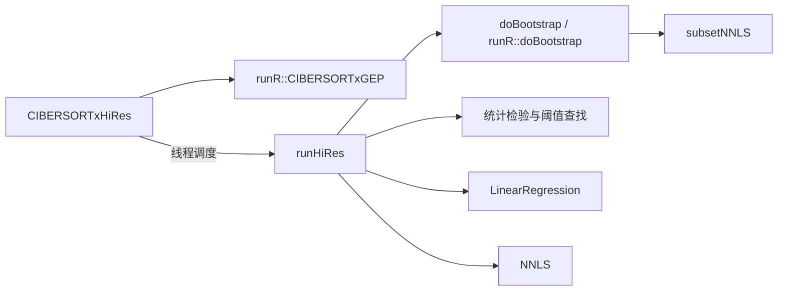

# 完整镜像调查与数值源码恢复

日期：2026-10-11。本轮在本机完成；没有连接服务器，没有执行 CIBERSORTx，没有改动认证机制、研究数据或 EcoTyper 流程。

第二轮进一步核对了抽样、矩阵方向和窗口常量；优先阅读 [算法步骤与可实现性](算法步骤与可实现性.md) 和 [数值源码阅读目录](数值源码阅读目录.md)。下表及警告统计已更新到第二轮的导出范围。

## 这次实际推进到了哪里

**已经找全这三个固定版本镜像中的应用文件，并获得 HiRes 与 Fractions 主要数值函数的反编译伪代码。仍未得到作者完整原始 C++ 源码，也未生成可以运行或与网页数值等价的替代程序。**

| 检查内容 | 结果 | 应如何理解 |
|---|---|---|
| 官方镜像标签 | Fractions、GEP、HiRes 当前各有一个 `latest` 标签 | 本轮没有发现其他官方标签可供继续寻找源码 |
| 镜像层扫描 | 63 个层记录，去重后 44 层；逐层核对 SHA256 | 包括基础层、依赖层、应用层和后续更新层，检查了早期层残留 |
| 全层文件目录 | 170,080 个文件/目录记录，包含跨镜像重复项 | 大量源码扩展名属于 Rcpp、Boost 等第三方依赖，不能当作项目源码 |
| 应用 C++/头文件 | `/src` 未发现；所有目录也未匹配到已识别的项目编译单元文件名 | 不能靠解压直接取得 `CIBERSORTxHiRes.cpp` 等原始文件 |
| R 源文件 | 25 个镜像内版本，12 个不同文件摘要；全部通过语法解析 | 包含真实可读实现，不是反编译结果 |
| R 函数片段 | 核对 45 个函数定义，导出 37 个片段，8 个暂未导出 | 数量包含镜像间重复；暂未导出的片段命中了保守筛选标记 |
| HiRes 反编译 | 171 个数值或辅助函数伪代码 | 已包含 `runHiRes`、`CIBERSORTxHiRes`、NNLS、bootstrap、统计检验、回归及数值依赖 |
| 两个 Fractions 编译版本 | 每个检查并导出 258 个函数伪代码 | 包含 signature 构建、比例求解、置换检验、S/B-mode 和 LIBSVM 相关函数；不能按数量计算算法覆盖百分比 |

Fractions 的独立镜像与 HiRes/GEP 内附带的 Fractions 可执行文件摘要不同，因此分别保存了两份分析结果。HiRes 和 GEP 中附带的 Fractions 则具有相同文件摘要。

`buildSignatureMatrix` 最初因 `rmTokensAndIG` 代码标识符中的 Tokens 命中保守筛选而未导出。第二轮独立诊断及辅助函数审阅确认这是基因标签过滤操作，已针对这个完整标识符加入精确例外，取得两个版本的构建主体伪代码；其余认证规则没有放宽。程序入口 `main` 和认证相关部分没有导出。

## 可以直接阅读的原始 R 实现

完整的无认证标记辅助 R 文件保存在 [vendor_reference](vendor_reference/) 下，按原始镜像与路径分开；经 R 语法树筛选的函数片段位于 [R_function_fragments](vendor_reference/R_function_fragments/)。这些文件仅供静态审阅，本轮没有执行。

最值得先看的内容：

- [runCIBERSORTxGEP 原始函数片段](vendor_reference/R_function_fragments/hires_f0bfeaddfa2e_runCIBERSORTxGEP.R)：群体表达推断的核心函数，保留原始行号来源。片段依赖原程序的全局对象和辅助函数，不能直接当作独立软件运行。
- [run_SVR.R](vendor_reference/hires/src/R_modules/run_SVR.R)：明确使用 `e1071` 的线性 nu-regression，读取待测试的 nu 值并输出模型权重。
- [run_adjust_w_pseudo.R](vendor_reference/hires/src/R_modules/run_adjust_w_pseudo.R)、[run_combatba.R](vendor_reference/hires/src/R_modules/run_combatba.R)：校正辅助实现。
- [run_optimization.R](vendor_reference/hires/src/R_modules/run_optimization.R)：优化辅助实现。

原始 GEP 文件使用 CRLF 换行。直接对 JSON 中的文本调用本机 R 的 `parse(text=)` 时发生解析错误；仅在解析输入中统一为 LF 后，25 个版本全部通过。原始镜像文件及摘要没有修改，这不是已证实的软件版本不兼容。导出片段也统一换行，逐行核对其内容与原始范围一致。

## 已经恢复的 HiRes 数值结构

以下是真实二进制生成的伪代码，文件中的地址与函数目录对应，保留 Ghidra 自动产生的类型和变量名。

| 作用 | 函数及阅读入口 | 本轮观察 |
|---|---|---|
| HiRes 主体调度 | [CIBERSORTxHiRes](decompiled_numeric/CIBERSORTxHiRes/numeric_001144fc.c) | 包含群体表达调用、数据准备和线程调度；通过线程对象传入 `runHiRes` |
| 样本级计算主体 | [runHiRes](decompiled_numeric/CIBERSORTxHiRes/numeric_0010cc9b.c) | 包含重复抽样、显著性相关计算、阈值查找、NNLS 和回归调用 |
| 重复抽样 | [doBootstrap](decompiled_numeric/CIBERSORTxHiRes/numeric_0010c9f7.c) | 调用 `subsetNNLS`，支持对子集进行数值估计 |
| NNLS 封装 | [nnlsFTWrapper](decompiled_numeric/CIBERSORTxHiRes/numeric_00125d3f.c) | 调用低层 `lh_nnls_`；低层函数也已导出 |
| 统计与矩阵操作 | [HiRes 函数目录](decompiled_numeric/CIBERSORTxHiRes/numerical_functions.tsv) | 包含 p 值调整、相关性、矩阵子集、均值/中位数和线性回归 |

下面是静态调用关系的简图，**不代表全部执行顺序或所有分支**：

原论文区分群体代表表达和样本级表达；本次发现两者有独立实现，并且 HiRes 会调用群体表达模块。这与论文的方法划分相符，但不证明反编译结果已经完整还原算法。[CIBERSORTx 原论文及 Methods](https://pmc.ncbi.nlm.nih.gov/articles/PMC6610714/)

## Fractions 和 S-mode 已经能看到什么

两个版本的阅读入口分别为 [HiRes 附带 Fractions 的函数目录](decompiled_numeric/CIBERSORTxFractions_hires/numerical_functions.tsv) 和 [独立 Fractions 的函数目录](decompiled_numeric/CIBERSORTxFractions_fractions/numerical_functions.tsv)。可以按 `Name` 找到对应伪代码文件。

实际静态调用证据包括：

- `CoreAlg` 调用 `runR::coreSVR`，并计算拟合相关指标。
- `doPerm` 调用 `CoreAlg`，所以置换检验是比例求解之外的一层计算。
- `runrmbatchSmode` 调用 `adjustSigMatrix`，然后再次调用 `CIBERSORTxFractions`。
- `adjustSigMatrix` 调用 `adjustMixtures` 和 NNLS；`adjustMixtures` 调用伪混合校正辅助模块等。

这些发现能帮助我们解释原先网页日志中的“S-mode 调整 signature 后再对 mixture 求比例”。它们只是算法和接口审计证据，本轮没有用研究样本检验运行行为。

## 距离可以可靠使用仍差哪些工作

反编译导出成功只表示工具产生了伪代码。HiRes 的 171 个文件中，134 个带反编译警告，90 个仍含 `undefined` 类型；独立和 HiRes 附带的两个 Fractions 版本分别有 138/148 个文件带警告，各有 157 个含未恢复类型。新增依赖也带有模板与类型警告，不能把文件总数的增长解释为验证程度提高。Ghidra 的异常处理分析还出现过反汇编警告，不能将工具“analysis succeeded”理解为逐行还原正确。

剩下的关键工作是：

1. 核对核心函数参数、矩阵方向、全局对象、容器布局和间接调用，补全丢失的类型信息。
2. 将论文中的窗口、抽样、筛选和平滑步骤逐段对应到伪代码，区分真实逻辑与编译器/模板代码。
3. 如以后实现可运行的独立算法，用已有小规模网页结果进行数值核对，再检查 EcoTyper 所需的各细胞类型“基因 × 样本”接口。当前还没有进行这些运行或等价性测试。

因此，现在可以进入有证据支持的算法解析，但还不能宣称“已拿到全部作者源码”“已重构官方软件”或“已解决 token 审批”。旧镜像也不能直接视为与当前网页版本数值一致。

## 如何复核这次工作

顺序与实际操作相同：

1. [完整层扫描脚本](../scripts/python/inventory_cibersortx_all_layers_20261011.py)：下载与校验公开层，逐层列目录，保存应用文件版本。
2. [工具准备脚本](../scripts/python/prepare_cibersortx_static_tools_20261011.py)：下载并校验便携 Ghidra/JDK。[Ghidra 官方项目](https://github.com/NationalSecurityAgency/ghidra)
3. [R 输入准备脚本](../scripts/python/prepare_cibersortx_R_parse_inputs_20261011.py) 与 [R 语法筛选脚本](../scripts/R/export_cibersortx_R_functions_20261011.R)：只解析、不执行源码，暂存原文用后删除。
4. [Ghidra 导出脚本](../scripts/java/AuditCibersortxNumerics.java) 与 [本机运行脚本](../scripts/powershell/Run-CibersortxStaticAudit-20261011.ps1)：分析三个不同 ELF 文件，导出通过筛选的数值函数伪代码。Java 类是 Ghidra 接口的必要结构。
5. [汇总与验证脚本](../scripts/python/summarize_cibersortx_source_recovery_20261011.py)：核对 R 片段原始内容、导出标记、反编译警告和文件摘要。
6. [浮点常量核对](../scripts/python/trace_cibersortx_numeric_constants_20261011.py)、[阅读索引](../scripts/python/build_cibersortx_implementation_map_20261011.py) 和 [独立数学核对](../scripts/R/check_cibersortx_numeric_contract_20261011.R)：补齐算法规则及可复核的阅读入口；数学检查不等同于供应商程序验证。

机器可读结果：[source_recovery_validation.json](source_recovery_validation.json)、[key_algorithm_functions.json](key_algorithm_functions.json)、[R_function_expression_audit.json](R_function_expression_audit.json)、[完整层扫描摘要](full_image_scan_summary.json)、[标签清单](official_tag_inventory.json)、[工具版本与官方摘要](static_tool_versions.json)。

原始供应商文件、反编译工作空间和伪代码保留本地，三者均通过本地 Git 排除规则保护，本轮没有提交或推送任何内容。不要将这些文件自动作为项目自写的可发表代码发布；项目自写审计脚本与方法记录单独保存。
